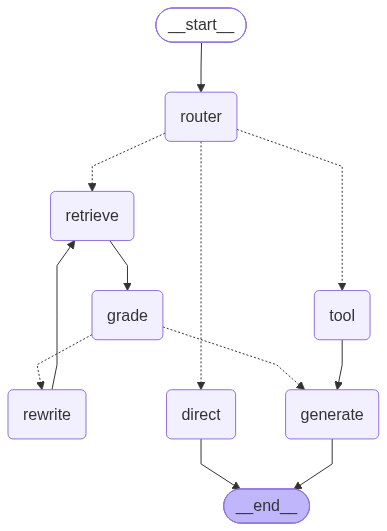
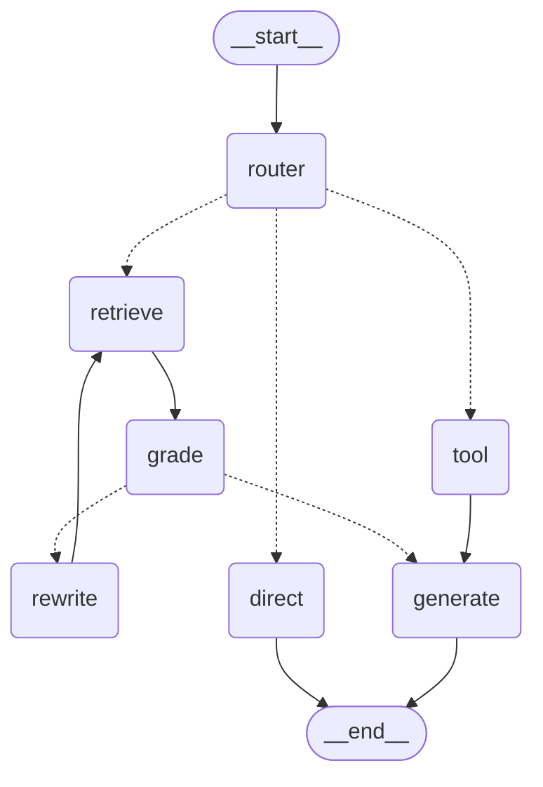

# 4.2 - The LangGraph workflow

`src/graph.py` is the agent. The diagram is generated from the compiled graph itself
(`docs/make_diagram.py`), so it cannot drift from the code:

- `docs/4.2_workflow.png` - rendered topology
- `docs/4.2_workflow.mmd` - the Mermaid source





## Why a graph and not a chain

The control flow is **conditional and cyclic**. Whether a question touches the notes at all is a
runtime decision; whether one retrieval is enough is decided by a *grader* node; and a failed grade
loops back through query rewriting. That `rewrite -> retrieve` edge is the whole reason this is a
graph - a `RAG | prompt | model` chain cannot express it, and it is exactly what task 4.3 measures.

## State

`AgentState` is a `TypedDict`. Every node returns only the keys it changed, and `trace` is an
append-only channel with a reducer (`Annotated[list[dict], lambda a, b: a + b]`), so each node can
contribute its own span without coordinating with the others.

| Group | Keys |
|---|---|
| input | `question`, `query` |
| routing | `route`, `route_reason`, `tool_name`, `tool_input` |
| retrieval | `docs`, `query`, `retry_count` |
| grading | `grade_relevant`, `grade_score`, `grade_reason` |
| tool | `tool_result`, `tool_ok` |
| output | `answer`, `sources`, `confidence` |
| observability | `trace` |

## Nodes

| Node | Responsibility | Calls |
|---|---|---|
| `router` | classify into retrieve / tool / direct | `llm.route` |
| `retrieve` | top-k cosine search for the current query | `rag.retrieve_docs` |
| `grade` | does the retrieved context actually answer the question? | `llm.grade` |
| `rewrite` | turn the question into a keyword query for another try | `llm.rewrite` |
| `tool` | run the calculator or formula lookup | `tools.run_tool` |
| `generate` | write the grounded answer (or refuse) | `llm.generate` |
| `direct` | answer small-talk without touching the corpus | `llm.generate` |

## Edges

- `START -> router`
- `router -> retrieve | tool | direct` (conditional on `route`)
- `retrieve -> grade`
- `grade -> generate | rewrite` (conditional, see below)
- `rewrite -> retrieve` (the retry cycle)
- `tool -> generate`, `generate -> END`, `direct -> END`

### The grade decision, including the floor

```python
def _route_after_grade(state):
    if state["grade_relevant"]:                       # good context -> answer
        return "generate"
    if state["grade_score"] < LOW_COVER_FLOOR:        # ~no overlap at all -> hopeless, give up
        return "generate"                             # (low-confidence branch)
    if state["retry_count"] < MAX_RETRIES:            # borderline -> one more attempt
        return "rewrite"
    return "generate"                                 # out of retries -> answer best-effort
```

`MAX_RETRIES` defaults to 2 and `LOW_COVER_FLOOR` to 0.15. The floor is the fix for a failure found
during the first evaluation run: for questions the notes simply cannot answer, the naive agent
rewrote the query and re-retrieved **repeatedly** to no effect, because "the query was bad" and "the
topic is absent" look identical to a lexical grader. Skipping the retry when there is essentially no
lexical overlap halves the node count and the latency on unanswerable questions - measured in
`eval/improvement_retry.json` (8 -> 4 nodes, 49 -> 22 ms per question).

## Tools

Defined in `src/tools.py`, deliberately two, both offline:

- **`calculator`** - evaluates a numeric expression via a **restricted AST walk**, never `eval`.
  Tool input is untrusted text and `eval` on model output is how a demo becomes an RCE. Handles
  `pi`, `e`, `^` and `x`.
- **`formula_lookup`** - a curated table of canonical ECE formulas/constants with their source
  document (Nyquist, Shannon, Carson, settling time, VSWR, quarter-wave, ...). A study assistant
  over a fixed corpus should cite the corpus; a web-search tool would break reproducibility. The
  README shows the one-line change to add one.

## Memory

The graph is compiled with a `MemorySaver` checkpointer and every call passes a `thread_id`, so a
conversation thread's state persists across invocations. The demo uses one thread per turn.

## Inspecting a run

Every node appends `{node, detail, elapsed_ms}` to `state["trace"]`. `eval/local_tracer.py` renders
that to a waterfall PNG (`docs/traces/`) - the local stand-in for the LangSmith run view when no
`LANGSMITH_API_KEY` is configured. With a key set, the same run is also traced remotely.

```powershell
python src/graph.py "How does a quarter-wave transformer match a transmission line?"
```
